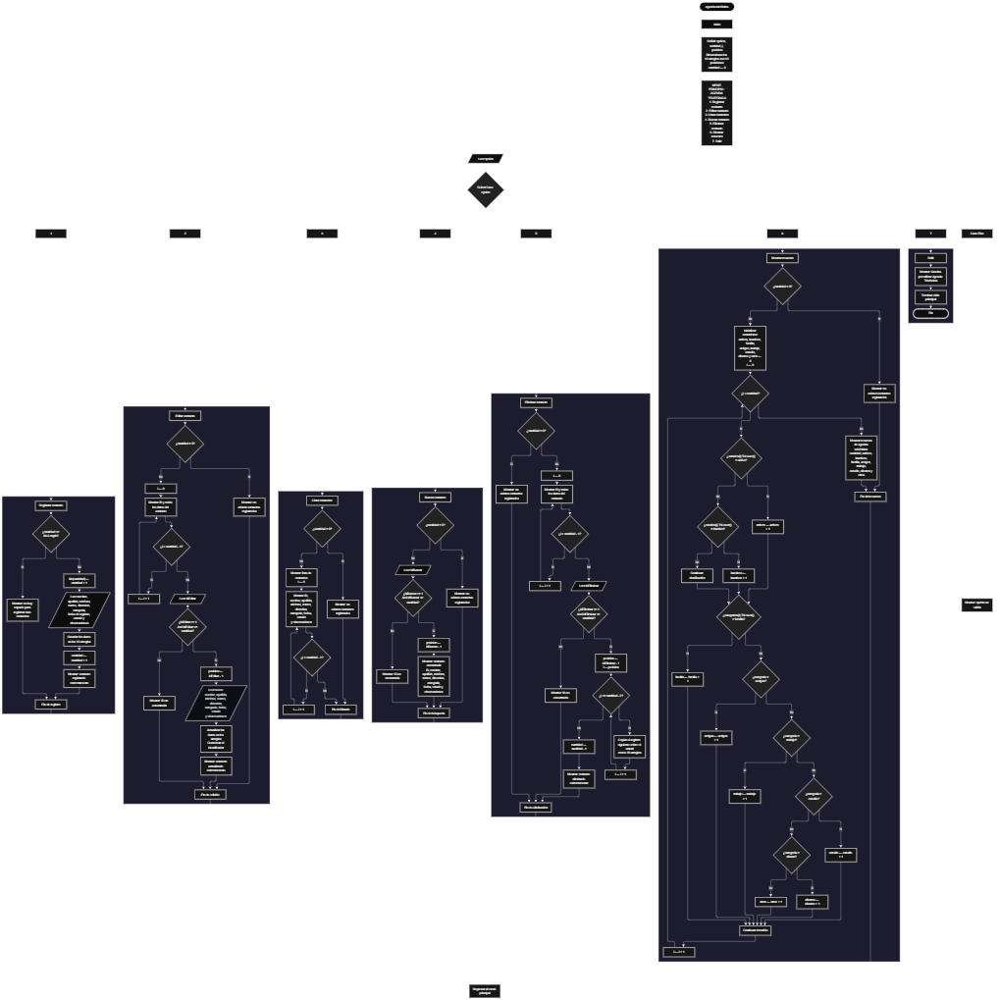

Este proyecto, llamado <b>agenda telefónica</b>, fue desarrollado en <b>visual basic .net</b> como un ejercicio práctico para fortalecer la lógica de programación mediante la creación de un sistema de gestión de contactos desde la consola. El programa cuenta con un menú principal de siete opciones que permite <b>registrar, editar, eliminar, buscar, listar y consultar un resumen</b> de los contactos almacenados. Cada contacto contiene información como el nombre, apellido, teléfono, correo electrónico, dirección, categoría, fecha de registro, estado y observaciones. Para administrar estos datos se utilizan diez arreglos paralelos con una capacidad máxima de <b>10 contactos durante la ejecución</b>. Durante su desarrollo se aplicaron conceptos fundamentales de programación, como variables, arreglos, estructuras condicionales, ciclos repetitivos y estructuras de selección, además de procesos para buscar, modificar, eliminar y organizar registros. Este proyecto permite poner en práctica los conocimientos adquiridos en Visual Basic .NET y sirve como base para desarrollar sistemas de gestión más completos utilizando otros lenguajes y tecnologías.

<h2 align="center">⚙️ Funcionamiento del menú principal</h2>

### ➕ Registrar contacto

La opción <b>1) registrar contacto</b> permite almacenar una nueva persona en la agenda telefónica. Antes de realizar el registro, el programa comprueba que la cantidad de contactos almacenados sea menor que la capacidad del arreglo mediante la condición <b>cantidad &gt;= ids.Length</b>. Como los arreglos tienen diez posiciones, el sistema permite registrar hasta <b>10 contactos</b>. Si existe espacio disponible, asigna automáticamente un identificador mediante <b>ids(cantidad) = cantidad + 1</b> y solicita los datos del contacto: <b>nombre, apellido, teléfono, correo, dirección, categoría, fecha de registro, estado y observaciones</b>. Cada dato se almacena en la posición correspondiente de su respectivo arreglo. Finalmente, incrementa la variable <b>cantidad</b> en uno y muestra el mensaje <b>"Contacto registrado correctamente."</b>. Si se alcanza la capacidad máxima, presenta el mensaje <b>"No hay espacio para registrar mas contactos."</b>, impidiendo agregar otro registro.

### ✏️ Editar contacto

La opción <b>2) editar contacto</b> permite modificar la información de una persona registrada. Primero, el programa comprueba si existen contactos almacenados mediante la condición <b>cantidad = 0</b>. Si la agenda está vacía, muestra el mensaje <b>"No existen contactos registrados."</b>. En caso contrario, utiliza un ciclo <b>For...Next</b> para mostrar los datos de todos los contactos registrados, incluyendo su identificador, nombre, apellido, teléfono, correo, dirección, categoría, fecha de registro, estado y observaciones. Después, solicita el ID del contacto que se desea editar y comprueba que se encuentre dentro del rango permitido mediante la condición <b>idEditar &gt;= 1 And idEditar &lt;= cantidad</b>. Si el identificador es válido, calcula la posición mediante <b>posicion = idEditar - 1</b> y solicita los nuevos datos del contacto, actualizando directamente los valores de los nueve arreglos de información. El identificador se conserva sin modificaciones. Finalmente, muestra el mensaje <b>"Contacto actualizado correctamente."</b>. Si el ID introducido no se encuentra dentro del rango permitido, presenta el mensaje <b>"ID no encontrada."</b>.

### 📋 Listar contactos

La opción <b>3) listar contactos</b> permite visualizar todos los contactos registrados actualmente en la agenda telefónica. Antes de mostrar la información, el programa comprueba si la variable <b>cantidad</b> es igual a cero. Si no existen registros, presenta el mensaje <b>"No existen contactos registrados."</b>. Si hay contactos disponibles, muestra el título <b>"lista de contactos"</b> y utiliza un ciclo <b>For...Next</b> para recorrer los arreglos desde la primera posición hasta la última posición ocupada. Durante el recorrido, muestra el ID, nombre, apellido, teléfono, correo, dirección, categoría, fecha de registro, estado y observaciones de cada contacto. Esta función facilita consultar la información almacenada sin necesidad de buscar cada persona individualmente.

### 🔎 Buscar contacto

La opción <b>4) buscar contacto</b> permite localizar un contacto mediante su identificador. Primero, el programa comprueba si existen contactos registrados. Si la agenda está vacía, muestra el mensaje <b>"No existen contactos registrados."</b>. En caso contrario, solicita el ID del contacto que se desea buscar y comprueba que se encuentre dentro del rango permitido mediante la condición <b>idBuscar &gt;= 1 And idBuscar &lt;= cantidad</b>. Si el identificador es válido, calcula la posición correspondiente mediante <b>posicion = idBuscar - 1</b> y muestra el mensaje <b>"contacto encontrado"</b>, seguido de todos los datos almacenados: <b>ID, nombre, apellido, teléfono, correo, dirección, categoría, fecha de registro, estado y observaciones</b>. Si el ID introducido no corresponde al rango de contactos registrados, presenta el mensaje <b>"ID no encontrada."</b>. Esta búsqueda utiliza directamente el identificador para calcular la posición del contacto dentro de los arreglos, sin realizar un recorrido para comparar los ID almacenados.

### 🗑️ Eliminar contacto

La opción <b>5) eliminar contacto</b> permite eliminar un contacto registrado mediante su identificador. Antes de comenzar, el programa comprueba que existan contactos almacenados. Si la agenda está vacía, muestra el mensaje <b>"No existen contactos registrados."</b>. Si hay registros disponibles, utiliza un ciclo <b>For...Next</b> para mostrar la información de todos los contactos. Después, solicita el ID del contacto que se desea eliminar y verifica que esté dentro del rango permitido mediante la condición <b>idEliminar &gt;= 1 And idEliminar &lt;= cantidad</b>. Si el identificador es válido, calcula la posición mediante <b>posicion = idEliminar - 1</b> y comienza el proceso de eliminación. Para mantener organizados los registros, utiliza otro ciclo <b>For...Next</b> que desplaza una posición hacia la izquierda los datos de los contactos posteriores en los diez arreglos: <b>ids, nombres, apellidos, telefonos, correos, direcciones, categorias, fechasRegistro, estados y observaciones</b>. Posteriormente, disminuye la variable <b>cantidad</b> en uno y muestra el mensaje <b>"Contacto eliminado correctamente."</b>. Si el ID introducido no se encuentra dentro del rango permitido, presenta el mensaje <b>"ID no encontrada."</b>. Los identificadores no se renumeran después de eliminar un contacto, por lo que la relación entre el ID y la posición puede dejar de coincidir.

### 📊 Mostrar resumen

La opción <b>6) mostrar resumen</b> permite consultar una descripción general de los contactos registrados en la agenda telefónica. Primero, el programa comprueba si existen contactos almacenados. Si la agenda está vacía, muestra el mensaje <b>"No existen contactos registrados."</b>. En caso contrario, inicializa las variables que contabilizan los estados y las categorías: <b>activos, inactivos, familia, amigos, trabajo, estudio, clientes y otros</b>. Después, utiliza un ciclo <b>For...Next</b> para recorrer todos los contactos registrados. Durante el recorrido, compara el contenido del arreglo <b>estados</b> mediante el método <b>ToLower()</b> para contabilizar los contactos con estado activo o inactivo. También compara el contenido del arreglo <b>categorias</b> para clasificar los contactos en las categorías familia, amigos, trabajo, estudio y cliente. Si una categoría no coincide con ninguna de estas opciones, aumenta el contador de <b>otros</b>. Finalmente, muestra el resumen de la agenda con la cantidad total de contactos, los contactos activos e inactivos y la distribución por categorías.

### 🚪 Salir del menú principal

La opción <b>7) salir</b> permite finalizar la ejecución del programa y muestra el mensaje <b>"Gracias por utilizar Agenda Telefonica."</b>. El menú principal se encuentra dentro de una estructura repetitiva <b>Do...Loop While</b>, que mantiene el programa en funcionamiento mientras la condición <b>opcion &lt;&gt; 7</b> sea verdadera. Cuando el usuario selecciona la opción 7, el programa ejecuta el mensaje de despedida y la condición del ciclo deja de cumplirse, finalizando correctamente la ejecución del menú principal.

<h2 align="center">🧠 Temas aplicados en el proyecto</h2>

### 📦 Variables

En este proyecto se utilizan variables para controlar la cantidad de contactos registrados, almacenar la opción seleccionada en el menú, recorrer los arreglos, identificar el contacto que se desea editar, buscar o eliminar y contabilizar los estados y las categorías durante la elaboración del resumen. Cada variable cumple una función específica dentro de las operaciones de gestión de la agenda telefónica.

🔢 **Ids:** Almacena los identificadores de los contactos registrados.

📊 **Cantidad:** Controla la cantidad actual de contactos almacenados.

🎯 **Opcion:** Almacena la opción seleccionada por el usuario en el menú principal.

🔄 **I:** Funciona como contador en los ciclos `For...Next` y permite recorrer las posiciones de los arreglos.

📍 **Posicion:** Almacena la posición del contacto seleccionado mediante el cálculo del identificador menos uno.

✏️ **IdEditar:** Almacena el identificador del contacto que se desea modificar.

🔎 **IdBuscar:** Almacena el identificador del contacto que se desea consultar.

🗑️ **IdEliminar:** Almacena el identificador del contacto que se desea eliminar.

📊 **Activos e Inactivos:** Contabilizan los contactos según su estado.

📂 **Familia, Amigos, Trabajo, Estudio, Clientes y Otros:** Almacenan la cantidad de contactos correspondientes a cada categoría.

### 🗃️ Arreglos

En este proyecto se utilizan diez arreglos paralelos relacionados con la información de cada contacto. Cada arreglo tiene una capacidad de <b>10 posiciones</b> y utiliza el mismo índice para representar los datos correspondientes a una misma persona. Por ejemplo, la información de un contacto almacenado en la posición <b>0</b> se encuentra distribuida entre <b>ids(0), nombres(0), apellidos(0), telefonos(0), correos(0), direcciones(0), categorias(0), fechasRegistro(0), estados(0) y observaciones(0)</b>. Esta organización permite recorrer, consultar, modificar, mostrar y eliminar los registros de manera relacionada.

🆔 **Ids(10):** Almacena los identificadores de los contactos registrados.

📝 **Nombres(10):** Almacena los nombres de los contactos.

👤 **Apellidos(10):** Almacena los apellidos de los contactos.

📞 **Telefonos(10):** Almacena los números telefónicos.

📧 **Correos(10):** Almacena las direcciones de correo electrónico.

🏠 **Direcciones(10):** Almacena las direcciones de los contactos.

📂 **Categorias(10):** Almacena las categorías de cada contacto.

📅 **FechasRegistro(10):** Almacena las fechas de registro.

🔖 **Estados(10):** Almacena los estados de los contactos.

📄 **Observaciones(10):** Almacena las observaciones adicionales de cada contacto.

### 🔀 Estructuras condicionales

En este proyecto se utilizan las estructuras <b>If...Then</b>, <b>ElseIf</b> y <b>Else</b> para controlar las diferentes operaciones del programa. Estas condiciones permiten comprobar si la agenda está vacía antes de editar, listar, buscar, eliminar o mostrar el resumen; verificar si existe espacio disponible antes de registrar un nuevo contacto; validar que el identificador introducido se encuentre dentro del rango permitido; y clasificar los contactos según su estado y categoría. De esta manera, el programa puede ejecutar diferentes instrucciones dependiendo de las condiciones encontradas durante cada operación.

### 🔄 Estructuras repetitivas

En este proyecto se utilizan las estructuras repetitivas <b>Do...Loop While</b> y <b>For...Next</b>. El ciclo <b>Do...Loop While</b> mantiene activo el menú principal y permite ejecutar las diferentes opciones hasta que el usuario selecciona la opción 7. Por otro lado, los ciclos <b>For...Next</b> permiten recorrer los arreglos para mostrar los contactos registrados, presentar los datos antes de editarlos o eliminarlos y contabilizar los estados y las categorías durante la elaboración del resumen. También se utiliza un ciclo <b>For...Next</b> para desplazar los datos de los contactos posteriores cuando se elimina un registro.

### 🎯 Estructura de selección

El programa utiliza la estructura <b>Select Case</b> para evaluar el valor almacenado en la variable <b>opcion</b> y ejecutar el bloque de instrucciones correspondiente. Cada caso representa una operación específica del sistema: <b>registrar, editar, listar, buscar, eliminar, mostrar resumen o salir</b>. También se utiliza el bloque <b>Case Else</b> para mostrar el mensaje <b>"Opcion no valida."</b> cuando el usuario introduce un número que no corresponde a ninguna de las opciones definidas en el menú principal.

### 🔢 Dimensionamiento de arreglos

El programa utiliza la instrucción <b>Dim</b> para declarar los arreglos que almacenan la información de los contactos. Cada arreglo se define con el índice máximo <b>9</b>, mediante declaraciones como <b>Dim nombres(9) As String</b>, lo que proporciona diez posiciones disponibles, desde el índice <b>0</b> hasta el índice <b>9</b>. La capacidad se controla mediante la propiedad <b>ids.Length</b>, que permite comprobar si todavía existe espacio para registrar nuevos contactos. Por otro lado, la variable <b>cantidad</b> mantiene el control de los registros que se encuentran ocupados durante la ejecución del programa.

### 🔄 Reorganización de registros

Cuando se selecciona un contacto para eliminarlo, el programa utiliza un ciclo <b>For...Next</b> que comienza en la posición seleccionada y llega hasta <b>cantidad - 2</b>. En cada repetición, los datos de la posición siguiente se copian sobre la posición actual en los diez arreglos: <b>ids, nombres, apellidos, telefonos, correos, direcciones, categorias, fechasRegistro, estados y observaciones</b>. Después, la variable <b>cantidad</b> disminuye en uno para actualizar el número de contactos registrados. De esta manera, los registros posteriores ocupan las posiciones anteriores sin dejar espacios vacíos entre los contactos activos. Sin embargo, el programa no actualiza los identificadores después del desplazamiento, por lo que pueden quedar desordenados con respecto a las posiciones que ocupan.

<h2 align="center">¿Cómo se implementaron las operaciones crud en el proyecto?</h2>

Las operaciones <b>crud</b> se implementaron mediante las opciones del menú principal, permitiendo administrar la información de los contactos registrados. La operación <b>crear</b> corresponde a <b>registrar contacto</b>, donde se introducen los datos de una nueva persona; <b>leer</b> se realiza mediante las opciones <b>buscar contacto, listar contactos y mostrar resumen</b>, que permiten consultar los registros y su clasificación; <b>actualizar</b> corresponde a <b>editar contacto</b>, donde se modifican los datos de una persona registrada; y <b>eliminar</b> se realiza mediante la opción <b>eliminar contacto</b>, que reorganiza los datos de los arreglos después de quitar un registro. Estas operaciones utilizan variables, arreglos, condicionales y ciclos para gestionar la información almacenada temporalmente durante la ejecución del programa.

<h2 align="center">Diagrama de flujo del proyecto</h2>

<h2 align="center">🛡️ Validaciones del programa</h2>

### 📭 No existen contactos registrados

Esta validación se utiliza en las opciones de <b>editar, listar, buscar, eliminar y mostrar resumen</b>. El programa comprueba si la variable <b>cantidad</b> es igual a <b>0</b> y, si no existen contactos registrados, muestra el mensaje <b>"No existen contactos registrados."</b>. Esta comprobación evita continuar con las operaciones que necesitan información almacenada cuando la agenda está vacía.

### ⚠️ Capacidad máxima de la agenda

Esta validación se utiliza durante el registro de nuevos contactos para controlar la capacidad máxima de los arreglos. El programa comprueba si <b>cantidad &gt;= ids.Length</b> antes de permitir agregar un nuevo registro. Como los arreglos tienen diez posiciones, la condición impide registrar más de diez contactos. Si existe espacio disponible, el programa solicita los datos y aumenta la variable <b>cantidad</b>. En caso contrario, muestra el mensaje <b>"No hay espacio para registrar mas contactos."</b>, impidiendo agregar otro contacto.

### 🔢 Identificador dentro del rango permitido

Esta validación se utiliza en las opciones de <b>editar, buscar y eliminar contactos</b>. El programa comprueba que el identificador introducido sea mayor o igual a <b>1</b> y menor o igual a la variable <b>cantidad</b>, utilizando condiciones como <b>idBuscar &gt;= 1 And idBuscar &lt;= cantidad</b>. Si el identificador se encuentra dentro del rango permitido, calcula la posición mediante <b>posicion = id - 1</b> y ejecuta la operación correspondiente. Si no cumple la condición, muestra el mensaje <b>"ID no encontrada."</b>. Esta comprobación valida el rango numérico, pero no verifica que el identificador coincida realmente con el valor almacenado en el arreglo.

### 📂 Clasificación de estados y categorías

Esta validación se utiliza durante la opción <b>mostrar resumen</b>. El programa compara los estados de los contactos mediante <b>estados(i).ToLower()</b> para contabilizar los valores <b>"activo"</b> e <b>"inactivo"</b>. También compara las categorías mediante <b>categorias(i).ToLower()</b> para clasificar los contactos como <b>familia, amigos, trabajo, estudio o cliente</b>. Si una categoría no coincide con ninguna de las anteriores, se contabiliza dentro de <b>otros</b>. Esta clasificación no impide registrar valores diferentes, sino que determina cómo se contabilizan durante el resumen.

### ⚠️ Identificadores después de eliminar contactos

Durante la eliminación, el programa desplaza los datos de los arreglos hacia la izquierda y disminuye la variable <b>cantidad</b>, pero no renumera los identificadores almacenados. Como las opciones de edición, búsqueda y eliminación calculan la posición mediante <b>ID - 1</b>, después de eliminar un contacto intermedio el identificador puede dejar de coincidir con la posición real del registro. Por este motivo, las operaciones posteriores pueden acceder a un contacto diferente del que corresponde al ID introducido. Esta situación representa un aspecto que se puede mejorar en futuras versiones del proyecto.

### ⚠️ Entrada de datos y formatos

El programa utiliza <b>Convert.ToInt32(Console.ReadLine())</b> para convertir la opción del menú y los identificadores introducidos en números enteros. Si el usuario introduce un valor que no puede convertirse a entero, se puede producir una excepción durante la ejecución. Además, los campos de texto se almacenan directamente mediante <b>Console.ReadLine()</b>, sin comprobar si están vacíos o si contienen información válida. Las fechas, los teléfonos y los correos se almacenan como cadenas de texto, por lo que el programa no realiza una validación específica de sus formatos.

### ❌ Opción inválida

La estructura <b>Select Case</b> incluye el bloque <b>Case Else</b>, que muestra el mensaje <b>"Opcion no valida."</b> cuando el usuario introduce un número que no corresponde a ninguna de las siete opciones definidas en el menú. Después de mostrar el mensaje, el programa vuelve al menú principal porque el ciclo <b>Do...Loop While</b> continúa mientras la opción seleccionada sea diferente de <b>7</b>.

<h2 align="center">🎯 Objetivo del proyecto</h2>

El objetivo principal de este proyecto es fortalecer la <b>lógica de programación</b> mediante el desarrollo de un sistema de gestión de contactos en <b>visual basic .net</b>. A través de su construcción se busca aplicar los conocimientos adquiridos sobre variables, arreglos, estructuras condicionales, ciclos repetitivos y estructuras de selección, integrándolos para resolver un problema de manera organizada. Además, el proyecto permite comprender cómo registrar, consultar, modificar, eliminar y clasificar información mediante arreglos paralelos en una aplicación de consola, estableciendo una base para desarrollar sistemas de gestión más completos con otros lenguajes y tecnologías.

